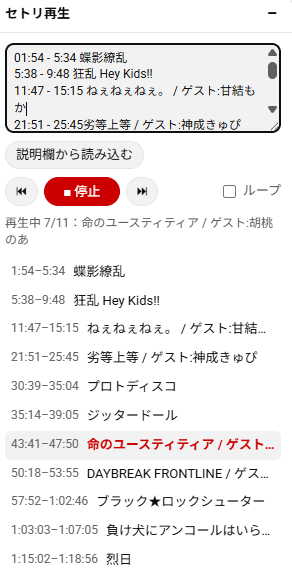

# YouTube セトリ再生

YouTube のライブアーカイブや歌枠で、**曲の部分だけを順番に再生する**ユーザースクリプトです。
曲の終わりに来ると自動で次の曲の頭へ飛ぶので、MC や待ち時間を飛ばして聴けます。



## できること

- タイムスタンプを貼るだけで、曲の区間だけを連続再生
- 曲の終わり → 次の曲の頭へ自動ジャンプ（MC・休憩をスキップ）
- 曲一覧からクリックでその曲へ移動、⏮ / ⏭ で前後の曲へ
- 最後の曲のあと先頭に戻るループ再生
- 説明欄のタイムスタンプを読み込み
- 入力したセトリは動画ごとに自動保存
- YouTube のダークモードに合わせて表示が切り替わる

## 必要なもの

- Chrome / Edge / Firefox などのパソコン用ブラウザ
- 拡張機能 [Tampermonkey](https://www.tampermonkey.net/)
- スクリプト本体 `youtube-setlist-player.user.js`

## インストール

### 1. Tampermonkey を入れる

ブラウザの拡張機能ストアから Tampermonkey をインストールします。

### 2. ユーザースクリプトを許可する（Chrome / Edge）

Chrome では、この設定をオンにしないとスクリプトが動きません。

1. アドレスバーに `chrome://extensions` と入力して開く
2. Tampermonkey の「詳細」を押す
3. 「ユーザー スクリプトを許可する」をオンにする
4. 同じ画面の「サイトへのアクセス」が「すべてのサイト」になっていることを確認する


> 「ユーザー スクリプトを許可する」が見当たらない場合は、Chrome のバージョンが古い可能性があります。拡張機能ページ右上の「デベロッパー モード」をオンにしてください。

Tampermonkey のメニューに「拡張機能の設定で『ユーザー スクリプトを許可する』を有効にしてください」と出ている場合も、この手順で直ります。

### 3. スクリプトを登録する

1. ツールバーの Tampermonkey アイコンから「新規スクリプトを追加…」を開く
2. 最初から入っているテンプレートを全部消す
3. `youtube-setlist-player.user.js` の中身を貼り付ける
4. `Ctrl + S`（Mac は `⌘ + S`）で保存する


### 4. 動作を確認する

YouTube の動画ページを開くか、開いていた場合は再読み込み（F5）します。
画面右下に「セトリ再生」のパネルが出れば準備完了です。

## 使い方

### 基本の流れ

1. 聴きたいライブアーカイブを開く
2. パネルの入力欄にセトリを貼る（書き方は下を参照）
3. 「▶ 開始」を押す

あとは曲の区間だけが順番に再生されます。最後の曲が終わると停止します。


### セトリの書き方

1 行に 1 曲、時刻と曲名を書きます。

```
0:03:15 - 0:07:40 曲名A
0:12:05 - 0:16:30 曲名B
1:02:10〜1:06:45 曲名C
```

| 書き方 | 意味 |
| --- | --- |
| `開始 - 終了 曲名` | 開始〜終了の区間だけを再生し、終了時刻で次の曲へ飛ぶ |
| `開始 曲名` | 終了を省略。次の曲の開始時刻まで流しっぱなし（最後の曲なら動画の終わりまで） |

細かいルールは次のとおりです。

- 時刻は `1:02:10`（時:分:秒）と `12:05`（分:秒）のどちらでも書けます。
- 開始と終了の区切りは `-` `〜` `~` `–` `—` のどれでも構いません。
- 時刻は行の先頭でも末尾でも認識します（`曲名 1:20:00` も OK）。
- 時刻を含まない行（「MC」などのメモ）は無視されます。
- 行の順番がばらばらでも、開始時刻の順に自動で並べ替えます。
- 入力は手を止めて約 0.4 秒後に自動で反映されます。反映ボタンはありません。

> **MC を飛ばしたい場合は終了時刻を書いてください。**
> 開始時刻だけだと、曲と曲の間の MC もそのまま再生されます。

### 説明欄から読み込む

「説明欄から読み込む」を押すと、動画の説明欄からタイムスタンプを含む行だけを取り出して入力欄に入れます。
説明欄のセトリは開始時刻だけのことが多いので、読み込んだあとに MC を飛ばしたい曲だけ終了時刻を書き足すのがおすすめです。

セトリが固定コメントなど説明欄以外にある場合は、コピーして入力欄に貼り付けてください。

### ボタンの説明

| 操作 | 動き |
| --- | --- |
| ▶ 開始 / ■ 停止 | セトリ再生のオン・オフ。停止中は普通の YouTube と同じように再生される |
| ⏮ / ⏭ | 前の曲 / 次の曲の頭へ移動 |
| 曲一覧の行をクリック | その曲の頭から再生（停止中なら再生を開始） |
| ループ | オンにすると、最後の曲のあと最初の曲に戻る |
| 見出し右の「–」 | パネルをたたむ / ひらく |

再生中の曲は一覧で色が変わり、パネル内の表示に「再生中 2/10：曲名」のように出ます。

### 保存について

入力したセトリは動画ごとにブラウザに保存され、同じ動画を次に開いたときに自動で読み込まれます。
保存先はそのブラウザの中だけなので、別のパソコンやブラウザには引き継がれません。

## 注意事項

- 曲の切り替わり判定は 0.1 秒ごとなので、0.1〜0.3 秒ほどのずれが出ることがあります。
- 広告の再生中は判定を止めているため、広告で誤ってジャンプすることはありません。
- フルスクリーン中はパネルが見えませんが、自動ジャンプは動き続けます。
- 配信が終わったアーカイブ向けです。配信中のライブでの動作は確認していません。
- 入力欄に文字を打っている間は、YouTube のショートカットキー（K・J・L など）は効きません。
- YouTube の画面構成が変わると動かなくなる可能性があります。

## うまく動かないとき

**パネルが出ない**

- Tampermonkey のアイコンを押して、「YouTube セトリ再生」がオンになっているか確認する
- 「インストール」の手順 2（ユーザースクリプトの許可）ができているか確認する
- トップページや検索結果ではなく、動画の再生ページ（`youtube.com/watch?v=...`）を開いているか確認する
- ページを再読み込み（F5）する

**「説明欄にタイムスタンプが見つかりません」と出る**

セトリが説明欄ではなくコメント欄にある可能性があります。コメントからコピーして貼り付けてください。

**曲名がおかしい / 曲が一覧に出ない**

その行に `分:秒` の形の時刻が入っているか確認してください。`3分15秒` のような書き方は認識しません。

## 仕組み

- 0.1 秒ごとに動画の再生位置を確認し、今どの曲の区間にいるかを判定しています。
- どの曲の区間にもいない（MC 中など）と判定したら、次の曲の開始位置へシークします。
- YouTube はページを再読み込みせずに動画を切り替えるため、`yt-navigate-finish` イベントで動画の切り替わりを検知し、その動画用のセトリを読み込み直しています。
- YouTube は Trusted Types により `innerHTML` を禁止しているので、パネルはすべて `createElement` で組み立てています。

## 似たツール

- **HoloSongs**（Chrome 拡張）：Holodex のデータを使い、VTuber の歌枠ならセトリを入力せずに曲だけ再生できる
- **SponsorBlock**（Chrome / Firefox 拡張）：「Music: Non-Music Section」カテゴリで音楽以外の部分を飛ばせる（ユーザー投稿のため動画によっては未登録）

このスクリプトは、データが登録されていない動画でも自分でセトリを貼れば使える点が違いです。